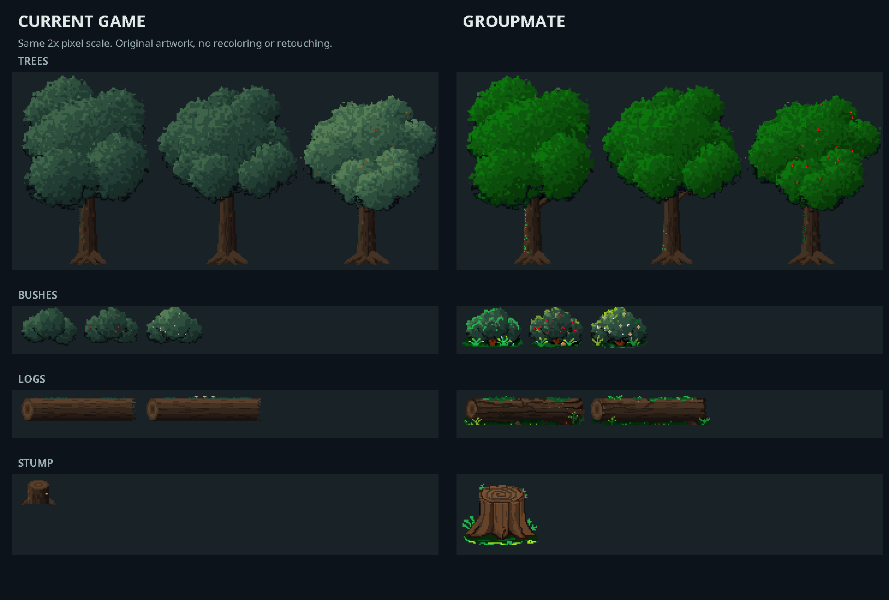

# Groupmate environment polish review — 2026-10-25

Source: [shared Google Drive folder](https://drive.google.com/drive/folders/1Ul5NaAXPOwmk0Dbxt3CP5NCtGssZS_7r). User identifies this as a groupmate’s work; individual artist name was not supplied. Four downloaded Pixilart projects are preserved byte-for-byte here for review. Drive files and runtime assets were not changed.

## Findings

| File | Contents | Compatibility and review |
| --- | --- | --- |
| trees.pixil | 348×162, three tree variants, one frame/layer | Matches `assets/props/forest/set_oak.png`, 116px per variant. Mostly stronger green coloring, some trunk highlights/red fruit. Tree silhouette remains largely unchanged (103 alpha changes). Greens are much more saturated than the muted current environment; harmonize the palette before importing. |
| bushes.pixil | 156×34, three bush variants, one frame/layer | Matches `set_bush.png`, 52px per variant. Adds visible trunks, grass, brighter berries/flowers and highlights. Useful detail, but brightest greens compete with gameplay cues; reduce the extreme highlights. |
| woods.pixil | 208×28, two log variants, two frames/layer per frame | First frame matches `set_log.png`, 104px per variant. Stronger bark cracks and grass give clearer form. Second frame has **zero nontransparent pixels**, versus 4319 in frame one: it is not a usable animation loop. Export frame one for a static prop, or complete/delete frame two in the editable source. |
| tree stump.pixil | 64×64, one frame/layer | Larger redraw with readable rings, roots and grass. Current `set_stump.png` is 34×26; `SetPieces.Kind.STUMP` uses width34, anchor(17,24), footprint44×20. Direct replacement crops to 34px and places the base incorrectly. Treat as a larger stump variant or recalibrate size, ground anchor, footprint and baked shadow together. |

All exported layer pixels use binary transparency (no partially transparent painted edges). Trees, bushes and logs preserve the current sheet dimensions. These correspond to the Corrupted Forest set in `SetPieces`, primarily area1, while the current focus is area0/Ruined Outpost. Chapter One placement would be a separate, intentional dressing change.

Recommendation: keep the log bark and stump improvements; bring foliage colors into the game’s palette, remove the blank log frame, then preview placement at actual game scale. The large stump can provide variation without replacing every small stump.

## Inspection performed

Read every Pixilart JSON frame/layer and decoded its embedded PNG losslessly. Compared all four with the current runtime PNGs, checked dimensions/transparency and the renderer’s cell selection/anchor behavior. Comparison uses nearest-neighbor 2x scaling with no recoloring/retouching. `wood-frames.png` exposes the empty frame against a solid background. Runtime code/assets, saves and Drive sharing were left intact. No live in-game placement, collision or animation test was run because nothing was imported.

## Integration — 2026-10-25

User approved implementation after the review. All four imports are now in `assets/props/forest/`: same tree/bush/log sheet layouts, harmonized foliage colors, authored bark/roots/ground accents, and a48×48 stump with recalibrated anchor(24,42) and64×26 footprint. The forest floor was rebaked from the updated metrics. The log export and integrated editable project have one complete frame; the blank original frame is excluded. Original groupmate projects and previous runtime PNGs are preserved in [the source folder](../../../assets/source/forest/groupmate-2026-10-25/README.md).

These assets remain in the Corrupted Forest, where their existing placements belong. No Chapter One scenery, routes or combat were changed. The user explicitly deferred voice work; no voice API calls or voice integrations were made during this task.

Actual isolated game renders: [Root crossing](integrated/forest-0.png), [southern trail](integrated/forest-1.png), [western forest](integrated/forest-2.png). Rendered with the real game code and current assets using save-free test state, not an image mockup. Runtime art has not been hand-playtested yet.

Verification: all101 test classes passed through `build.sh` after the source/metrics changes. After a final foliage-only palette correction, ForestArtTest and PixelConsistencyTest passed again; the final JAR's PackagedAssetLoadingTest passed from `/tmp`, including forest collision/path reachability and all prop loading. ZIP readback matched all four current PNGs byte-for-byte; source/editable files are excluded. `git diff --check` passed. No canonical save edits or live-game restart.
