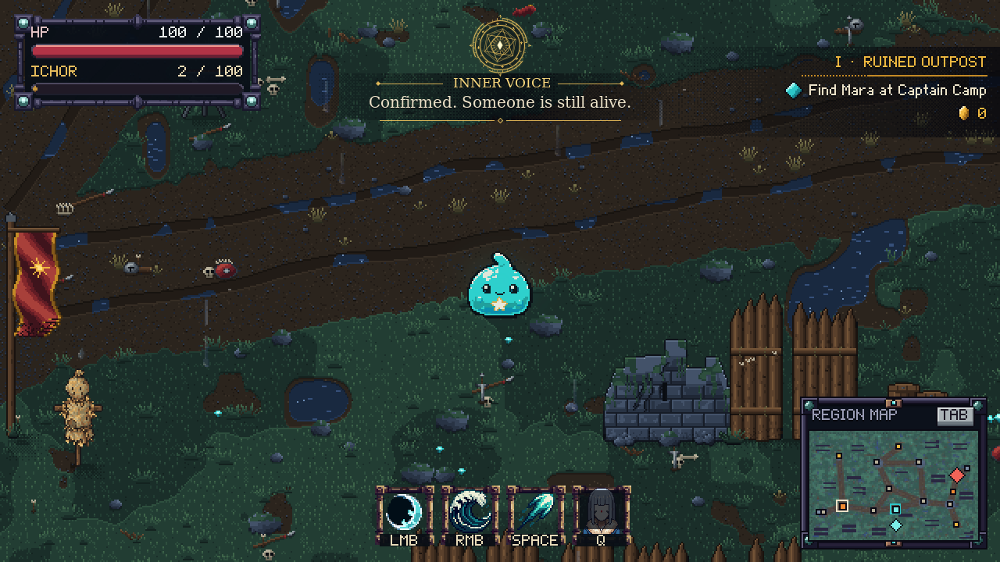
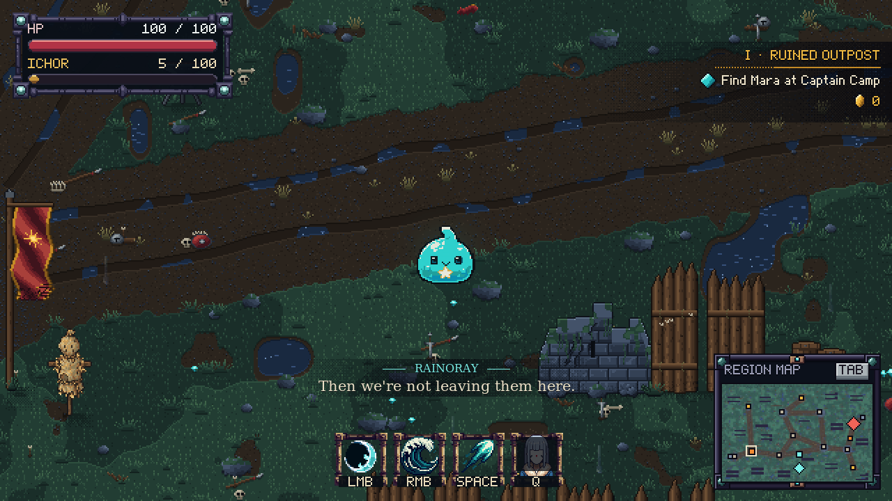

# Inner voice gold overlay — 2026-10-25

The approved compact design places a 78-pixel gold seal at top center, with a small speaker label and one readable serif subtitle directly beneath it. Counter-rotating rings and the speech-driven core remain. A softly fading dark backing and thin gold rules replace the large side seal, connector and lower panel. The whole overlay stays within a 480 by 160 top-center region, clear of the player, health bars, quest tracker, skills and minimap. Reference direction: the [Raphael abstract manifestation](https://tensura.fandom.com/wiki/Raphael); no reference imagery is shipped.

The survivor-discovery observation now plays the approved three-line Rainoray / inner-voice exchange. Movement stays available. The gold seal appears only on the inner-voice turn, fades at its boundaries, freezes in Reduce Effects mode and stops on combat, dialogue replacement, title return or death. Pause freezes the conversation and audio. Speech level comes from the existing mixer; music and combat sounds cannot drive the seal.

Existing saves keep the original once-per-campaign discovery flag. This does not reset progress or replay an already-heard discovery. The separate preview stages this conversation in memory and offers a Replay conversation button. It never reads or writes the player's save.

```sh
javac --release 17 -cp build/B2BJ.jar -d /tmp/b2bj-inner-voice-preview tools/PreviewInnerVoice.java
java -cp build/B2BJ.jar:/tmp/b2bj-inner-voice-preview PreviewInnerVoice
```

To regenerate captures, pass an output directory and use `-Djava.awt.headless=true`. These screenshots are staged captures of the real game renderer, not an unassisted playthrough.



Voice masters, provenance and full processing settings remain in [voice auditions](../voice-auditions/README.md). The three runtime WAVs use the existing 22,050 Hz mono mixer. No new generation, account settings, commits or remote publication were required for this overlay.

## Compact design validation

User approved the smaller top-center mockup. Implemented with the existing seal renderer and packaged fonts; no generated screenshot is used as a runtime asset. Updated the runtime jar. Focused tests passed both against the changed class and against the packaged jar from `/tmp`: line sequence, movement, pause/interruption, rotation, speech pulse, reduced effects, compact footprint and recording coverage. Reviewed the real-game capture. The earlier full 102-class build passed before this layout-only revision; the full suite was not repeated for this visual change.

## Rainoray subtitle refinement

User rejected the remaining wide pixel subtitle strip. Quiet character speech now uses the approved sage serif type, a readable 16px speaker label, 21px dialogue and short cyan accents for Rainoray (warm accents for Mara). Its backing sizes to the actual line and fades at both edges. The compact lower subtitle stays clear of the player, skills and minimap; the approved sage remains at top center. Updated the existing exploration rendering path rather than adding a second dialogue system.



Focused `InnerVoiceOverlayTest`, `OutpostDialogueTest` and `MaraIdleTest` passed. The subtitle test checks every authored exploration line for fit and a bounded footprint. Packaged-jar validation also passed. Full gameplay suite/playthrough not repeated for this presentation-only change.

## Boss combat — 2026-10-25

Combat-capable Sage barks now render during danger. The existing compact gold seal moves108pixels down while the boss bar is active, keeping the health bar readable. [Actual offscreen game rendering](sage-boss.png) shows a learned Ground Slam warning. This capture stages an active boss and bark; `SageCombatTest` separately exercises real learning, persistence and cooldown behavior.
