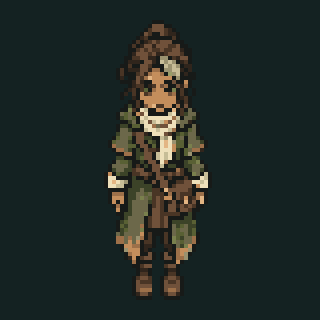

# Mara idle — 2026-10-25

Mara's existing 80px cutout now supplies twelve cached native-pixel poses over a 4.8-second loop: a one-pixel upper-body inhale, a small weight shift and one-pixel cloak/sleeve movement. Boots and lower legs remain fixed. No source artwork, character design, palette, interaction position or collision changed.

The world renderer uses its existing simulation clock, including during conversation. Pausing freezes it; reduced effects selects the neutral pose. This is a subtle runtime cutout idle, not a new directional walking sprite sheet.

MaraIdleTest checks the unchanged neutral pose, moving upper body, planted lower legs, palette preservation, loop closure, reduced effects, conversation clock and pause. OutpostDialogueTest and CampaignDesktopTest also passed. The rebuilt JAR was checked from outside the repository with MaraIdleTest and OutpostDialogueTest. Full campaign/balance and Windows playthrough were not repeated for this renderer-only change.
