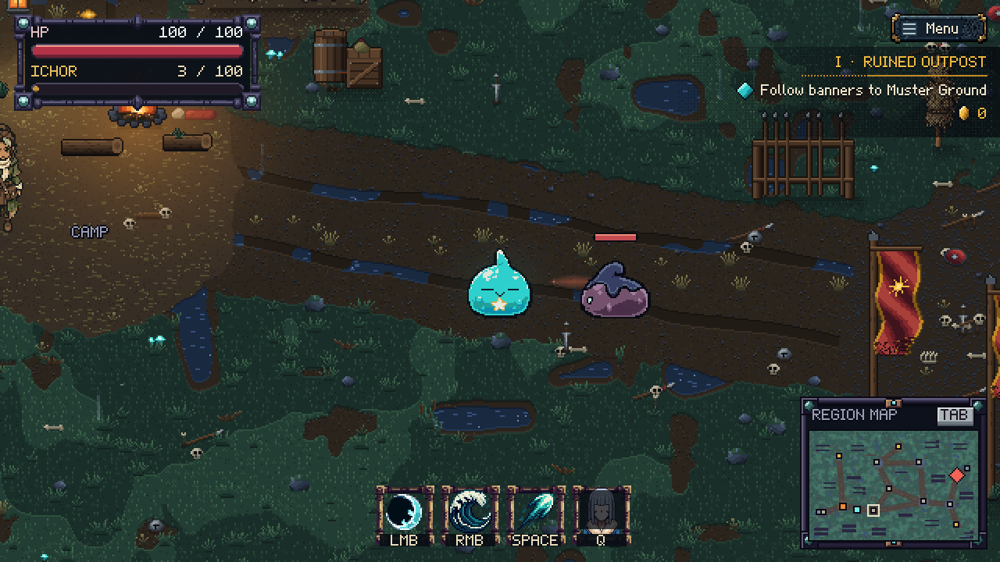

# Chapter One: camp-to-gate approach, 2026-10-25

This first chapter pass improves the existing east-road introduction rather than adding another quest system.

- Mara names the torn banners, Muster Ground and Inner Court, and gives one in-world warning about enemy windups.
- The goal follows the nearby road: camp, Muster Ground, Standard Yard, Inner Court, East Gatehouse. A hollow white marker identifies the next stop on both maps. It is a route suggestion, not a required visit, kill count or persistent quest flag. Northern exploration points toward Standard Yard, not back to the first encounter.
- The former three-enemy cluster at Muster Ground is spread along the east road: one remnant, one shield guard, then one spitter. Total Outpost population stays at 21. Camp stays outside their normal awareness, and later patrols keep their mixed composition.
- Outpost remnants now have a 0.60s windup, commit their direction for its final 0.30s and recover for 0.70s. Damage, travel speed, lunge reach and rewards are unchanged. Forest imps and legacy scouts retain 0.40s windup and 0.45s recovery.
- Remnant/guard directional glints extend beyond the sprite silhouette, bounded by the actual attack reach. The previous short tip was almost entirely hidden beneath the body.

[Camp route on the region map](camp-route-map.png).

OutpostApproachTest checks quiet camp, one introductory threat engaging at a time, clear enemy spawn footprints, the walkable main road, northern-route guidance, boss access without mandatory visits, committed direction, safe recovery, and a visible cue outside the sprite. Captures come from the real Java framebuffer; no desktop screenshots or mock UI.

Validation: all 96 test programs passed; seven focused checks passed again after the final cue/wording adjustments, and the repackaged JAR passed asset loading from outside the repo. Full build and final focused-check logs live under `/home/ghiankylledomingo/tmp/b2bj-outpost-approach/`. This is not a full manual balance playthrough. Warden move-set changes, a new opening cinematic and further environmental art remain separate work.
