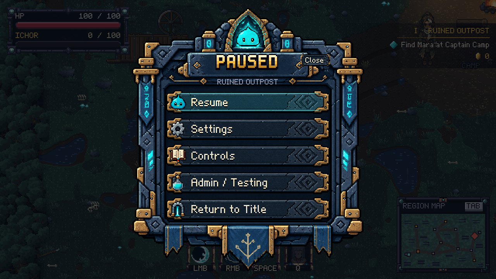

# Stone pause menu — 2026-10-25

Ghian selected the generated stone mockup after rejecting the earlier code-drawn panels. The live menu now uses actual generated slate-frame, carved-plate and icon assets. The slime crest, cyan runes, brass fittings and hanging banners are part of the artwork; headings, labels and all controls remain live UI.

- Slow crest/rune pulse and three small crest motes.
- Short light sweep when selection changes, plus a static cyan selected plate.
- Pressed plate and label move down together.
- Reduced effects disables decorative motion and sweeps.
- The menu clock runs while gameplay stays paused.

Sources and generation specifications: [stone-menu assets](../../../assets/ui/stone-menu/README.md). Runtime renders on a native 2x grid with nearest-neighbor sampling. The superseded procedural PauseIcons implementation was removed.

[Six-second in-engine motion preview](stone-menu-motion.mp4) shows successive selections.

## Screens

- [Pressed Resume](menu-pressed.png)
- [Settings](menu-settings.png)
- [Controls](menu-controls.png)
- [Testing](menu-admin.png)
- [Protected-session home](menu-protected-home.png)

Native buttons, keyboard navigation, mnemonics, accessible control descriptions, sliders and test-session save protection remain. Close lives inside each page; the duplicate corner button hides while the menu is open. Pointer and keyboard selection share one active row. Controls stay in their own scrollable page.

StoneMenuArtTest covers animated vs. reduced renders, sweep expiry, press feedback, the 2x effect grid and frozen gameplay during menu animation. CampaignMenuTest covers navigation, layout, settings, testing and captures the screens above. PackagedAssetLoadingTest requires all three new assets. All 95 assertion test programs passed through build.sh, including packaged asset loading from outside the repository. The rebuilt JAR contains all three stone textures and StoneMenuArt. Build log: /home/ghiankylledomingo/tmp/b2bj-stone-menu/build.log.

Scope is the pause/options/controls/testing menu and its existing corner control. No full manual campaign or Windows run was repeated for this revision.
