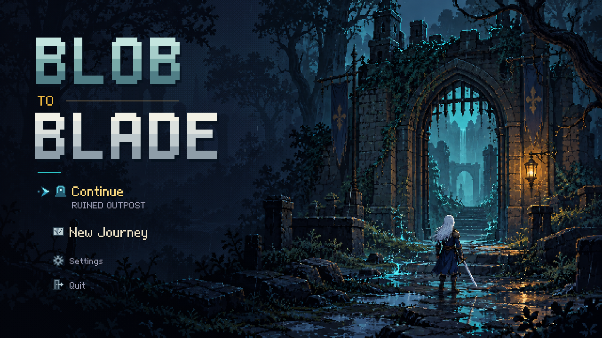
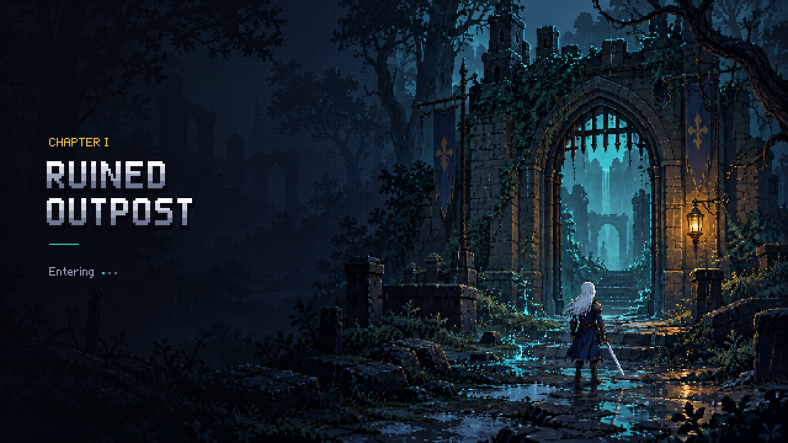

# Title menu icons — 2026-10-25

Existing kit symbols: gate for Continue, map for New Journey, gear for Settings, door for Quit. All occupy a 24-pixel square beside aligned labels. The current blue selection chevron stays separate. Icons use silver when idle, cyan when selected, and dim gray when unavailable. Menu behavior, accessible labels, keyboard navigation and save confirmation are unchanged.

Palette conversion preserves outlines and map details. `TitleMenuIconsTest` checks visible distinct symbols, fixed bounds, three shades, selection shape stability and disabled-state precedence. Temporary preview uses its own save.

## Chapter scene

The outpost transition reuses `TitleScreen.drawBackdrop`: existing gate art, grounded Rainoray, hair and coat wind, lantern light, water and rain. Chapter typography moves left. Removed the floating transformation display for the outpost, long randomized tips (including obsolete red-line guidance), decorative flourish and nine bouncing drops. A three-dot activity indicator replaces the row. Skip and entry/reform timing remain unchanged; reduced effects freeze scene movement and dots. Other regions retain their own silhouettes and transformation art, with the simpler text layout.

`LoadingScreenTest` checks scene preservation, reduced effects and transition/skip timing. No new image assets or dependencies.
